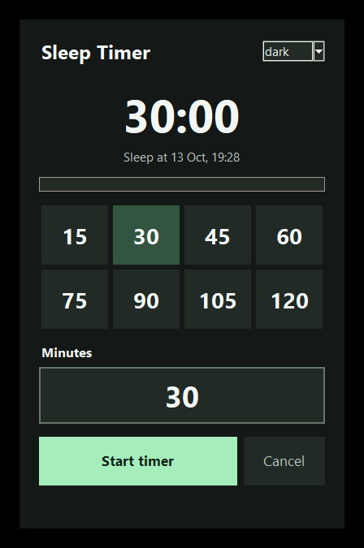
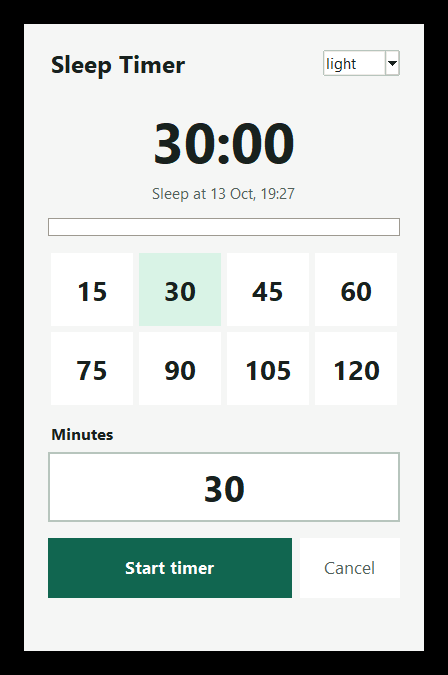

# Sleep Timer

A compact Windows sleep timer with large, high-contrast time controls.

## Download 1.1.2

[Download SleepTimer_1.1.2.exe for Windows x64](https://github.com/jamps3/Sleep-Timer/raw/refs/heads/main/dist/SleepTimer_1.1.2.exe)

No Python installation is needed for the executable. This build is unsigned;
Windows may show a reputation warning. Only run downloads from this repository.

## Features

- Eight visible minute presets: 15, 30, 45, 60, 75, 90, 105 and 120.
- Large custom input accepting 1 to 9,999,999 whole minutes (maximum seven digits).
- Live countdown, scheduled sleep time and progress indicator.
- Start and Cancel controls; Enter starts and Escape cancels a running timer.
- Persistent light, dark and system theme settings.
- After the Windows sleep command returns, reports its elapsed duration. This is
  not a measurement of the user's sleep.

## Run

Requires Windows, Python 3.8+ and Tkinter (included with standard Python for Windows).

```powershell
py sleep_timer_gui.py
```

Choose a preset or enter whole minutes, then click Start timer. Save your work
first: Windows sleep is requested when the countdown reaches zero. Cancel stops
the countdown before that request; it cannot undo an already-issued sleep command.

Theme changes are saved beside the script in `settings.json`. Window height adapts
to the controls' requested size so larger Windows display scaling does not hide
the action buttons. GUI updates run on Tk's main thread.

## Screenshots

| Dark | Light |
|---|---|
|  |  |

Original `screenshot.png` and `screenshot2.png` are retained. See [CAPTURE.md](CAPTURE.md)
for reusable window capture, transparent padding and safe preview generation.
Pillow is needed only for capture/preview tools, not the timer itself.

```powershell
py -m pip install Pillow
py -m unittest -v test_capture_window.py
py preview_timer.py --output-dir previews
```

The preview runner disables sleep. Automated tests do not exercise actual system
suspension or wake-up. Version 1.1.2 is packaged with PyInstaller and smoke-tested
in safe preview mode; real system suspension/wake-up is not yet tested.

## Building

Install PyInstaller, then run `build.bat`. `VERSION` identifies the release and
is not incremented automatically. The checked-in spec handles embedded Tcl/Tk 9
resources as well as conventional Tcl/Tk installations.

```powershell
py capture_release.py dist/SleepTimer_1.1.2.exe --output-dir previews
```

This captures the packaged app in both themes with sleep disabled. FrameFree is
now also an independent project in `../Screenshotter`, with its own tests and Git.

## License

[MIT](LICENSE).
